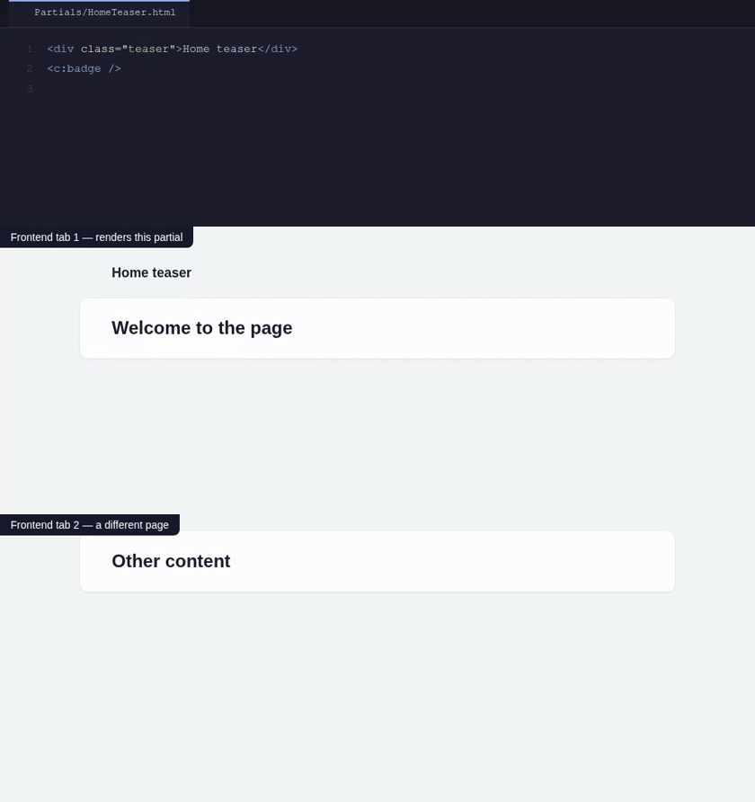
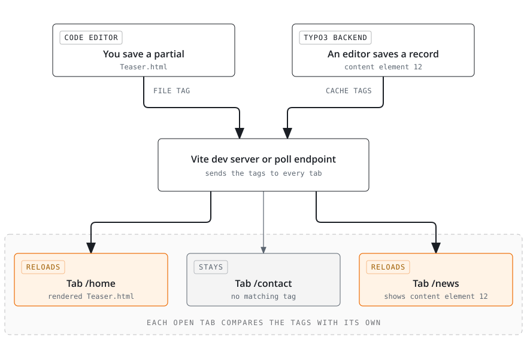

<p align="center"></p>

<h1 align="center">Live Reload</h1>

<p align="center"><em>Save a Fluid partial in your editor — or a record in the TYPO3 backend.<br>The browser tabs that show it reload. All other tabs stay as they are.</em></p>

<p align="center"><a href="https://wazum.github.io/typo3-live-reload/"><strong>Overview and demo</strong></a></p>

<p align="center">
  <a href="https://github.com/wazum/typo3-live-reload/actions/workflows/tests.yml"></a>
  <a href="https://get.typo3.org"></a>
  <a href="https://www.php.net"></a>
  <a href="https://packagist.org/packages/wazum/typo3-live-reload"></a>
  <a href="LICENSE"></a>
</p>

## The idea

The usual live reload setup watches the template folder and reloads every open tab. Tabs
that never showed the changed file lose their scroll position, their form input and their
open dialogs.

This extension reloads only the tabs that show the change. Each page knows what it
rendered: its TYPO3 cache tags and the Fluid files it used. Each change becomes the same
kind of tag. A tab reloads only when its tags and the tags of the change overlap.



## What reloads

| You change | What reloads |
|---|---|
| A Fluid template, partial or layout | the tabs that rendered it |
| A Fluid component (`<my:atom.button>`) | the tabs that rendered it |
| A ViewHelper class | the tabs whose templates use it |
| A record in the TYPO3 backend | the tabs that show it |
| CSS or TypeScript | Vite's hot update, often without a reload (through vite-asset-collector) |

Vite's own hot reload can't handle the Fluid rows, because server-rendered Fluid never
enters its module graph.


## How it works

<picture>
  <source media="(max-width: 700px)" srcset="Documentation/diagrams/how-it-works-narrow.svg">
  
</picture>

1. While TYPO3 renders a page, the extension records the page's cache tags and the Fluid
   files the render used. A middleware writes them into the page as `window.__liveReload`,
   together with a small client script.
2. When an editor saves a record, TYPO3 flushes its cache tags. The extension collects
   them and sends them on after the editor's response has gone out.
3. When you save a watched file, the Vite plugin turns it into a `file:` tag. PHP is not
   involved — the watcher is the signal.
4. In the Development context, the Vite dev server sends the tags to every tab over the
   WebSocket it already holds open, once per batch. TYPO3 also keeps the tags in a table,
   and tabs without a dev server poll a small endpoint for them.
5. Each tab compares the tags with its own and reloads only when they overlap.

## Installation

```bash
composer require --dev wazum/typo3-live-reload
```

That is all you need for content reloads. In the Development context they work at once:
open some frontend pages, edit content in the backend, and the right tabs reload. Without
a Vite dev server, each tab asks a small endpoint for changes.

For file reloads, add the plugin to `vite.config.ts`. It ships with the Composer package,
so you don't need an npm package:

```ts
import { defineConfig } from 'vite'
import { liveReload } from './vendor/wazum/typo3-live-reload/Resources/Private/Vite/dist/index.js'

export default defineConfig({
    plugins: [
        // ...your other plugins
        liveReload({
            watch: { paths: ['packages'] }, // your extension/template directories
        }),
    ],
})
```

The import path is relative to `vite.config.ts`. With the plugin, Vite pushes changes over
the WebSocket it already holds open, so the tabs stop polling. Leave out `watch` if you
only want content reloads.

> [!IMPORTANT]
> Turn on the `frontend.cache.autoTagging` feature toggle. Only new TYPO3 installations
> have it on by default:
>
> ```php
> $GLOBALS['TYPO3_CONF_VARS']['SYS']['features']['frontend.cache.autoTagging'] = true;
> ```
>
> Without it, content reloads only happen for edits on the page you are looking at.

You need TYPO3 13.4 or 14.3, PHP 8.2 or newer, and Vite 5.1 or newer if you use the dev
server.

## Good to know

- Visitors get nothing. The extension only runs in the contexts you allow (by default
  `Development`), and a plain `Production` context never counts. Outside Development, it
  also needs a backend login.
- Editors can use it on a staging site without a dev server. A saved record reloads their
  preview tabs ([reloads for editors](Documentation/content-reloads.md#reloads-for-editors-without-a-dev-server)).
- Saving in the backend is never slower, and a failed broadcast never breaks a save.
- If a change breaks the page, you see the TYPO3 error page as usual. Fix the error, and
  the tab reloads by itself. A few errors, such as a broken `Services.yaml` or PHP running
  out of memory, need one manual reload after the fix.
- A page without tag data reloads on every change, so it never misses one.
- The scroll position stays, even when a framework such as Turbo sets
  `history.scrollRestoration = 'manual'`.
- A cancelable `typo3:live-reload` event fires before each reload, so you can
  [morph the page in place](Documentation/morph.md) instead.
- CSP nonces are handled for you ([Content Security Policy](Documentation/content-security-policy.md)).
- The [Admin Panel module](Documentation/admin-panel.md) shows the connection, the page's
  cache tags and a live feed of broadcasts. It can also pause reloads for your session.

## Documentation

| Document | What it covers |
|---|---|
| [File reloads](Documentation/file-reloads.md) | how files are recorded, the `watch` option, the page cache, limits |
| [Content reloads](Documentation/content-reloads.md) | cache tags, reloads for editors, tags from other extensions, limits |
| [Configuration](Documentation/configuration.md) | all settings, the dev server URLs, the shared secret, Vite plugin options |
| [Morph instead of reload](Documentation/morph.md) | updating the page in place with Turbo or idiomorph |
| [Admin Panel](Documentation/admin-panel.md) | the status dot, the three tabs, pausing reloads |
| [Content Security Policy](Documentation/content-security-policy.md) | what the extension does for CSP and what is left for you |
| [CHANGELOG.md](CHANGELOG.md) | what changed in each release |

## Licence

GPL-2.0-or-later, see [LICENSE](LICENSE).
